### Hi there 👋

<picture>
  <source media="(prefers-color-scheme: dark)" srcset="./profile/stats-dark.svg">
  
</picture>

<picture>
  <source media="(prefers-color-scheme: dark)" srcset="./profile/languages-dark.svg">
  
</picture>

<!-- Generated daily with [GitHub Stats Extended](https://github.com/stats-organization/github-stats-extended). -->
